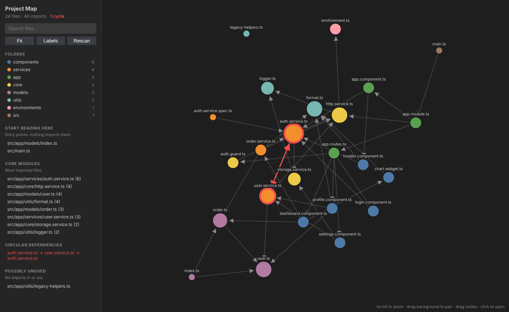

# CodeSense

**Understand any codebase, not just the file you're staring at.**

CodeSense is a VS Code extension that helps developers and students get up to speed on unfamiliar code. It explains what a piece of code does, why a file exists, and how the whole project fits together. It does this by combining static analysis (ASTs and dependency graphs) with optional AI explanations.

> Understanding code is harder than writing it. Most AI tools focus on generating code. CodeSense focuses on explaining what's already there.



---

## ✨ Features

### 🗺️ Project Map
An interactive dependency graph of your whole project, drawn with a hand-written force-directed layout (no chart libraries).

- **Files clustered and colored by folder**, sized by how many files import them
- **Hover** a file to highlight what it imports and what imports it, with a tooltip showing its role and stats
- **Click** a node to open the file, **drag** to rearrange (dragged nodes stay pinned; double-click to release), **scroll** to zoom
- **Start reading here**: detected entry points (files nothing imports)
- **Core modules**: the most-imported files a newcomer should understand first
- **Circular dependencies**: found with Tarjan's SCC algorithm and drawn in red
- **Possibly unused**: files with no imports in or out
- **Live updates** on save, plus file create/delete/rename events


### 📄 Explain This File
Shows what a file is *for*: its likely role (Angular component/service/module, React component, test, barrel, config, type definitions), its exports, internal helpers, what it depends on, and **which files use it**.

### 🔍 Explain Selection
Select code and choose **CodeSense: Explain Selection**. It lists what the selection declares, what it calls, and which imported modules those calls come from. With AI enabled, you get a structured explanation: summary, step-by-step, inputs/outputs/side effects, and gotchas.

### 🔒 Local-First AI (optional)
Structure analysis runs entirely on your machine. AI explanations are **off by default**. When enabled, CodeSense talks to any OpenAI-compatible endpoint. The default is a local [Ollama](https://ollama.com) server, so your code never has to leave your laptop.

The AI receives **static-analysis facts as context** (file role, dependencies, importers) instead of only raw code, so explanations are grounded in how the file actually fits into the project.

---

## 🏗️ How It Works

```
┌──────────────┐    ┌──────────────────┐    ┌───────────────────┐
│  Workspace   │───▶│  fileAnalyzer    │───▶│  ProjectIndex     │
│  files       │    │  (TS Compiler    │    │  analyses + import│
└──────────────┘    │   API → AST)     │    │  graph (adjacency)│
                    └──────────────────┘    └─────────┬─────────┘
                                                      │
                     ┌────────────────────────────────┼─────────────────┐
                     ▼                                ▼                 ▼
             ┌──────────────┐               ┌──────────────┐   ┌───────────────┐
             │ Explain      │◀── facts ─────│ graph.ts     │──▶│ Project Map   │
             │ (LLM, opt.)  │               │ SCC, entries,│   │ (webview,     │
             └──────────────┘               │ hubs, orphans│   │  force layout)│
                                            └──────────────┘   └───────────────┘
```

1. **Parse**: each file is parsed into an AST with the TypeScript Compiler API. CodeSense collects imports (including re-exports, `require()` and dynamic `import()`), top-level symbols, class members and decorators.
2. **Index**: relative imports are resolved to real files (handling `index.ts` and ESM-style `.js` → `.ts`) into a project-wide adjacency map. Saving a file re-analyzes only that file.
3. **Analyze**: pure graph algorithms find cycles (Tarjan's SCC, O(V+E)), entry points, hubs and orphans.
4. **Present**: results appear in the explanation panel and the Project Map webview, with a strict Content Security Policy and no remote resources.

### Project structure
```
src/
├── extension.ts             # activation, commands, file watchers
├── analysis/
│   ├── fileAnalyzer.ts      # AST → imports, symbols, roles
│   ├── projectIndex.ts      # workspace index + import resolution
│   └── graph.ts             # cycles, entry points, hubs, orphans (pure, tested)
├── commands/
│   ├── explainFile.ts
│   └── explainSelection.ts
├── llm/provider.ts          # OpenAI-compatible client
├── ui/
│   ├── explanationPanel.ts  # explanation webview
│   └── projectMap.ts        # map webview + payload builder
└── test/                    # node:test unit tests
media/
├── projectMap.js            # force-directed graph (vanilla JS, SVG)
└── projectMap.css
```

---

## 🛠️ Tech Stack

| Area | Tools |
|---|---|
| Extension | TypeScript, VS Code Extension API |
| Parsing | TypeScript Compiler API |
| Algorithms | Tarjan's SCC, degree analysis, incremental indexing |
| Visualization | Webview + hand-written force-directed layout in SVG |
| AI (optional) | Any OpenAI-compatible API, Ollama for local models |
| Testing | `node:test` |

---

## ⚙️ Settings

| Setting | Default | Description |
|---|---|---|
| `codesense.llm.enabled` | `false` | Turn on AI explanations |
| `codesense.llm.baseUrl` | `http://localhost:11434/v1` | OpenAI-compatible endpoint |
| `codesense.llm.model` | `llama3.1` | Model name |
| `codesense.llm.apiKey` | `""` | API key (empty for Ollama) |

---

## 🚧 Roadmap

- [x] Explain selected code
- [x] File responsibility summary
- [x] Dependency graph + Project Map webview
- [x] Circular dependency detection
- [x] Incremental re-indexing on save
- [x] Local model support (Ollama)
- [ ] `tsconfig` path aliases (`@app/...`) in import resolution
- [ ] Angular-aware explanations (templates, DI tree, routing)
- [ ] .NET support (C# via tree-sitter)
- [ ] Guided Tour: suggested reading order for newcomers
- [ ] Publish to VS Code Marketplace

---

## 🚀 Development

Requires Node.js 22+.

```bash
git clone https://github.com/alamdilshad87/CodeSense.git
cd CodeSense
npm install
npm run compile
npm test            # unit tests
```

Press **F5** in VS Code to launch an Extension Development Host with CodeSense loaded. Open any TS/JS project there, then run **CodeSense: Show Project Map** from the Command Palette.

To build an installable package: `npm run package` → `codesense-x.y.z.vsix`.

## 📄 License

MIT
