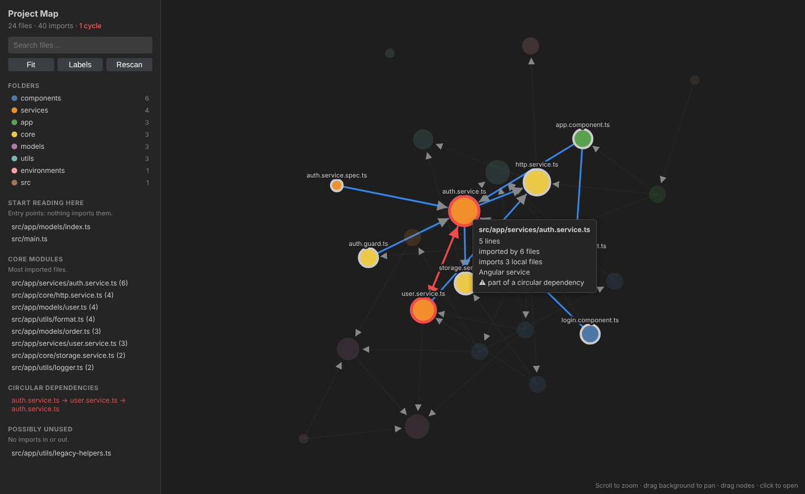

# CodeSense: Codebase Explorer

**Understand any codebase, not just the file you're staring at.**

CodeSense helps you get up to speed on unfamiliar code. It explains what a piece of code does, why a file exists, and how the whole project fits together. It uses static analysis of your code, with optional AI explanations.

## Features

### 🗺️ Project Map
An interactive dependency graph of your whole project.

- Files are **grouped and colored by folder** and sized by how many other files import them
- **Hover** a file to highlight what it imports and what imports it
- **Click** a file to open it, **drag** to rearrange, **scroll** to zoom
- **Start reading here**: the project's entry points
- **Core modules**: the most-imported files, worth understanding first
- **Circular dependencies**: highlighted in red
- **Possibly unused**: files nothing imports
- Updates automatically when you save

### 📄 Explain This File
See what a file is *for*: its likely role (Angular component or service, React component, test, config, etc.), its exports, what it depends on, and which files use it.

### 🔍 Explain Selection
Select some code to see what it declares, what it calls, and which imports it relies on. With AI enabled, you also get a plain-English explanation: summary, step by step, inputs and outputs, and gotchas.

## Usage

| Command | Where to find it |
|---|---|
| **CodeSense: Show Project Map** | Command Palette, the graph icon in the editor title bar, or right-click a folder |
| **CodeSense: Explain This File** | Right-click in the editor or on a file in the Explorer |
| **CodeSense: Explain Selection** | Select code, then right-click |

Supports **TypeScript and JavaScript** (`.ts`, `.tsx`, `.js`, `.jsx`, `.mjs`, `.cjs`).

## AI Explanations (optional)

CodeSense works fully offline by default. To add AI explanations, enable them in Settings. The default points at a local [Ollama](https://ollama.com) model, so your code stays on your machine. You can also use any OpenAI-compatible API.

| Setting | Default | Description |
|---|---|---|
| `codesense.llm.enabled` | `false` | Turn on AI explanations |
| `codesense.llm.baseUrl` | `http://localhost:11434/v1` | OpenAI-compatible endpoint |
| `codesense.llm.model` | `llama3.1` | Model name |
| `codesense.llm.apiKey` | `""` | API key (leave empty for Ollama) |

## Feedback

Found a bug or have an idea? [Open an issue](https://github.com/alamdilshad87/CodeSense/issues).

## License

[MIT](https://github.com/alamdilshad87/CodeSense/blob/main/LICENSE)
